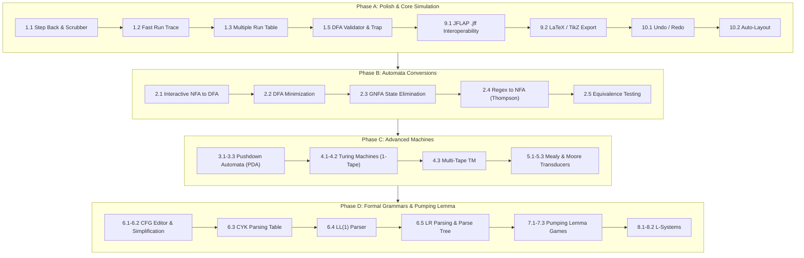

# TuringCanvas — Complete JFLAP Parity Implementation Roadmap & Prompt Suite

> **Document Version:** 1.0.0  
> **Date:** 2026-11-08  
> **Usage:** This document serves as the master implementation plan and prompt series for autonomous or pair-programming AI agents. Each task contains an exact, self-contained prompt adhering to the project's strict architecture guidelines.

---

## Architecture & Development Guardrails for Implementing Agents

Every prompt in this suite is designed to be handed to an AI agent. When executing any prompt, the agent **MUST** enforce the following rules:

1. **Clean Architecture Separation:**
   - `src/core/`: **Pure TypeScript only.** Zero React, zero DOM, zero UI dependencies, zero Zustand. Pure mathematical algorithms and data structures.
   - `src/types/`: Shared domain interfaces (`automata.ts`, `grammar.ts`, `pda.ts`, `tm.ts`, etc.) and UI-specific visual types (`ui.ts`).
   - `src/store/`: Zustand state management and adapters (e.g. `simulationAdapter.ts`). Core algorithms are invoked here, never directly in UI components.
   - `src/components/`: React 19 visual components and React Flow canvas rendering.
2. **Mandatory TDD Workflow (Red-Green-Refactor):**
   - Write Vitest unit tests in `src/__tests__/` **before** writing the production implementation.
   - Run tests to confirm failure (Red), implement minimal logic to pass (Green), and refactor cleanly.
3. **Strict TypeScript & Quality Standards:**
   - `strict: true`, `noUnusedLocals: true`, `noUnusedParameters: true`, `explicit-function-return-type: warn`.
   - **Zero `@ts-ignore` and zero `any`**.
   - Tailwind CSS v4 exclusively for styling.
4. **CI Verification Sequence:**
   Before declaring any task complete, the agent must run:
   ```bash
   npm run lint && npm run type-check && npm run test
   ```

---

# Epic 1: Simulation Enhancements & Batch Testing Suite

---

### Task 1.1: Bidirectional Stepping & Timeline Scrubber
**Context:** Currently, `useAutomataStore` only provides `stepForward()` and step index tracking. Pedagogically, students need to step backward (`stepBack()`) when analyzing why an NFA failed or which $\varepsilon$-transition was traversed, and jump directly to any step via a scrubber.

#### Agent Prompt 1.1:
```markdown
### TASK: Implement Bidirectional Simulation Stepping and Timeline Scrubber

#### 1. Objective
Add bidirectional simulation capabilities to TuringCanvas:
1. `stepBack()` action to revert to the previous simulation step.
2. `jumpToStep(stepIndex: number)` action to jump directly to any valid step.
3. Update `Sidebar.tsx` (SimulatePanel) to include a "Step Back" button, a timeline scrubber slider, and keyboard shortcuts (`ArrowLeft` / `ArrowRight`).

#### 2. Architecture & File Scope
- Modify `src/store/useAutomataStore.ts`:
  - Add `stepBack: () => void` and `jumpToStep: (stepIndex: number) => void` to `AutomataActions`.
  - In `stepBack`: decrement `currentStepIndex` if `> 0`. Update `activeNodeIds` to `simulationSteps[nextIndex]`. Reset `simulationAccepted` to `null` if we step back from the final step.
  - In `jumpToStep`: bounds-check `stepIndex` between `0` and `simulationSteps.length - 1`. Update `activeNodeIds` and evaluate `simulationAccepted` if reaching the final step.
- Modify `src/components/ui/Sidebar.tsx`:
  - In `SimulatePanel`: add a Step Back button (with back-arrow icon) next to Step Forward.
  - Add a `<input type="range" min={0} max={simulationSteps.length - 1} value={currentStepIndex} onChange={(e) => jumpToStep(Number(e.target.value))} />` slider when `isRunning`.
  - Add keyboard listeners for `ArrowLeft` (step back) and `ArrowRight` (step forward) when simulation is active.
- Tests in `src/__tests__/store.test.ts`:
  - Verify stepping forward then stepping backward restores exact `activeNodeIds` and resets `simulationAccepted`.
  - Verify stepping backward at step 0 is a no-op.
  - Verify `jumpToStep` correctly sets arbitrary steps and updates acceptance on the last step.

#### 3. Verification
Run `npm run lint && npm run type-check && npm run test`.
```

---

### Task 1.2: Fast Run & Simulation Trace Modal
**Context:** JFLAP provides "Fast Run", which instantly computes whether a string is accepted or rejected and presents the sequence of state transitions taken.

#### Agent Prompt 1.2:
```markdown
### TASK: Implement Fast Run and Execution Trace Modal

#### 1. Objective
Enable instant simulation of an input string without manual stepping, displaying an execution trace modal showing the exact path of states and symbols traversed.

#### 2. Architecture & File Scope
- Create `src/types/simulation.ts`:
  ```ts
  export interface ExecutionTraceStep {
    stepIndex: number;
    symbolConsumed: string | null; // null for step 0
    activeStateIds: string[];
    activeStateLabels: string[];
  }
  export interface FastRunResult {
    input: string;
    accepted: boolean;
    trace: ExecutionTraceStep[];
    totalSteps: number;
  }
  ```
- Modify `src/store/simulationAdapter.ts`:
  - Add `fastRun(nodes: AutomataNode[], edges: AutomataEdge[], input: string): FastRunResult | SimulationError`.
  - Leverage `buildAndSimulate` to generate all steps and map state IDs to labels for each step.
- Modify `src/store/useAutomataStore.ts`:
  - Add `fastRunResult: FastRunResult | null` to state.
  - Add `runFastSimulation: (input: string) => void` and `clearFastRun: () => void`.
- Create `src/components/simulation/FastRunModal.tsx`:
  - Modal displaying:
    - Input string with badge (Accepted in green, Rejected in red).
    - Scrollable table/list showing step number, symbol consumed, and active states.
    - Button to "Load into Stepper" (loads this simulation into the interactive stepper).
    - Close button / `Escape` handler.
- Modify `src/components/ui/Sidebar.tsx`:
  - Add "Fast Run" button in SimulatePanel.
- Tests in `src/__tests__/simulation.test.ts`:
  - Test `fastRun` on accepting and rejecting strings for both DFA and NFA graphs.
  - Verify trace accurately details symbols and state labels.

#### 3. Verification
Run `npm run lint && npm run type-check && npm run test`.
```

---

### Task 1.3: Multiple Run (Batch Testing Table)
**Context:** In academic grading and problem solving, students must test an automaton against multiple test cases (e.g., 10 positive and 10 negative strings). JFLAP's "Multiple Run" table is essential for this.

#### Agent Prompt 1.3:
```markdown
### TASK: Implement Multiple Run Batch Testing Table

#### 1. Objective
Provide a batch testing suite where users can enter multiple input strings, optionally specify expected results (Accept/Reject), run all inputs in parallel, and view pass/fail metrics.

#### 2. Architecture & File Scope
- Create `src/types/batchTest.ts`:
  ```ts
  export interface TestCase {
    id: string;
    input: string;
    expected?: 'accept' | 'reject';
    actual?: 'accept' | 'reject' | 'error';
    passed?: boolean;
    errorMessage?: string;
  }
  ```
- Modify `src/store/useAutomataStore.ts`:
  - Add `testCases: TestCase[]` to store state.
  - Actions:
    - `addTestCase: (input: string, expected?: 'accept' | 'reject') => void`
    - `removeTestCase: (id: string) => void`
    - `updateTestCase: (id: string, updates: Partial<TestCase>) => void`
    - `clearTestCases: () => void`
    - `runAllTestCases: () => void` (evaluates every test case using `buildAndSimulate` or `NFA.simulate`).
- Create `src/components/simulation/BatchTestModal.tsx`:
  - Tab or modal containing:
    - Editable table: Input string column, Expected outcome dropdown (Accept, Reject, Any), Result status column (Green checkmark, Red cross), Actions column.
    - Quick actions: "Run All", "Add Row", "Clear", "Import CSV/List", "Export Results".
    - Summary counter: "8/10 Passed (80%)".
- Integration in `src/components/ui/Sidebar.tsx`:
  - Add a button "Multiple Run / Batch Test" in SimulatePanel opening the modal.
- Tests in `src/__tests__/batchTest.test.ts`:
  - Test batch evaluation of 20 strings against a DFA.
  - Verify expected vs actual evaluation sets `passed` accurately.

#### 3. Verification
Run `npm run lint && npm run type-check && npm run test`.
```

---

### Task 1.4: Nondeterministic Configuration Tree Visualizer
**Context:** When simulating an NFA or NPDA, understanding the branching tree of computation paths is vital. JFLAP shows the full tree of configurations at each step.

#### Agent Prompt 1.4:
```markdown
### TASK: Implement Nondeterministic Branching Tree Visualizer

#### 1. Objective
Create a visual tree inspector that renders the branching computation tree for an NFA on a given input, showing which paths lead to acceptance, which dead-end, and which are currently active.

#### 2. Architecture & File Scope
- Create `src/types/computationTree.ts`:
  ```ts
  export interface TreeNode {
    id: string;
    stateId: string;
    stateLabel: string;
    remainingInput: string;
    children: TreeNode[];
    status: 'active' | 'accept' | 'reject';
  }
  ```
- Create `src/core/computationTreeBuilder.ts`:
  - Pure function `buildComputationTree(nfa: NFAData, input: string): TreeNode`.
  - Performs BFS/DFS up to a configurable max depth (e.g. 50) tracking transitions traversed, including $\varepsilon$-branches.
- Create `src/components/simulation/ComputationTreeDrawer.tsx`:
  - Collapsible drawer/panel rendering the tree nodes hierarchically using SVG or indented nested cards.
  - Color coding: Green for branches terminating in an accepting state, Red for dead-end branches, Amber for in-progress.
  - Clicking a node highlights that configuration on the main canvas.
- Tests in `src/__tests__/computationTree.test.ts`:
  - Verify tree structure for an NFA with multiple paths on the same symbol and $\varepsilon$-loops.

#### 3. Verification
Run `npm run lint && npm run type-check && npm run test`.
```

---

### Task 1.5: DFA Completeness & Determinism Validator
**Context:** JFLAP notifies users if their automaton is a valid DFA, if it contains non-deterministic transitions, or if any transitions for the alphabet are missing.

#### Agent Prompt 1.5:
```markdown
### TASK: Implement DFA Invariant & Completeness Validator with Auto-Trap Generation

#### 1. Objective
Provide real-time validation of an automaton to check:
1. Is the graph a valid DFA (no $\varepsilon$-transitions, exactly 1 transition per state per alphabet symbol)?
2. Identify missing transitions for any $(state, symbol)$ pair.
3. Provide a 1-click action: "Complete DFA" (automatically creates a dead/trap state $q_{trap}$ and routes all missing transitions to it).

#### 2. Architecture & File Scope
- Create `src/core/validation.ts`:
  ```ts
  export interface AutomatonValidationResult {
    isDFA: boolean;
    hasInitialState: boolean;
    initialStateCount: number;
    hasUnreachableStates: string[];
    missingTransitions: { fromStateId: string; symbol: string }[];
    nonDeterministicTransitions: { fromStateId: string; symbol: string; targetStateIds: string[] }[];
    epsilonTransitionsCount: number;
  }
  export function validateAutomaton(nodes: AutomataNode[], edges: AutomataEdge[]): AutomatonValidationResult;
  ```
- Create `src/core/trapStateGenerator.ts`:
  - Pure function `completeDFA(nodes: AutomataNode[], edges: AutomataEdge[]): { nodes: AutomataNode[]; edges: AutomataEdge[] }`.
  - Creates a trap state `q_trap` (non-accepting, with self-loops for all alphabet symbols) and connects all missing state-symbol transitions to `q_trap`.
- Store integration in `src/store/useAutomataStore.ts`:
  - Add `completeDFAWithTrap: () => void`.
  - Add `validationResult: AutomatonValidationResult` (memoized or computed on graph change).
- UI in `src/components/ui/ValidationBadge.tsx`:
  - Badge in Topbar: "DFA ✓" (green) or "NFA (3 missing transitions)" (amber).
  - Clicking opens a popover detailing missing transitions and the "Complete with Trap State" button.
- Tests in `src/__tests__/validation.test.ts`:
  - Test detection of missing transitions, non-determinism, unreachable states.
  - Test `completeDFA` ensures 100% transition coverage for $\Sigma$.

#### 3. Verification
Run `npm run lint && npm run type-check && npm run test`.
```

---

# Epic 2: Automata Transformations & Conversions

---

### Task 2.1: Interactive NFA to DFA Powerset Construction Wizard
**Context:** While `NFA.convertToDFA()` exists in `src/core/NFA.ts`, JFLAP's main educational value is its interactive wizard where students build the subset construction step-by-step.

#### Agent Prompt 2.1:
```markdown
### TASK: Implement Interactive NFA to DFA Powerset Construction Wizard

#### 1. Objective
Create an interactive learning wizard that guides the user through the Rabin-Scott Powerset Construction step-by-step:
1. User starts with initial subset state $E(q_0)$ ($\varepsilon$-closure of start state).
2. For each discovered subset and each alphabet symbol $a \in \Sigma$, the user either specifies the target subset or clicks "Expand Transition".
3. Provide "Step" (expands next unexpanded subset) and "Complete All" (instantly completes the construction).
4. Once finished, replace the canvas or open the resulting minimal DFA in a new workspace.

#### 2. Architecture & File Scope
- Create `src/core/powersetStepEngine.ts`:
  ```ts
  export interface PowersetStepState {
    alphabet: string[];
    discoveredSubsets: Map<string, Set<string>>; // subsetKey -> stateIds
    unexpandedSubsets: string[];
    transitions: { fromKey: string; symbol: string; toKey: string }[];
    initialKey: string;
    acceptingKeys: Set<string>;
    isComplete: boolean;
  }
  export function initPowersetStep(nfa: NFAData): PowersetStepState;
  export function expandNextStep(state: PowersetStepState, nfa: NFAData): PowersetStepState;
  export function completePowerset(state: PowersetStepState, nfa: NFAData): PowersetStepState;
  export function powersetToVisualGraph(state: PowersetStepState): { nodes: AutomataNode[]; edges: AutomataEdge[] };
  ```
- Create `src/components/conversions/NfaToDfaModal.tsx`:
  - Split-view modal: Left panel displays the original NFA; Right panel displays the powerset transition table and emerging DFA graph.
  - Controls: "Next Step", "Complete All", "Export to Canvas".
- Tests in `src/__tests__/powersetStep.test.ts`:
  - Verify step-by-step state progression matches batch `convertToDFA()`.
  - Test on NFAs with $\varepsilon$-transitions, dead branches, and cycles.

#### 3. Verification
Run `npm run lint && npm run type-check && npm run test`.
```

---

### Task 2.2: DFA Minimization (Hopcroft Equivalence Partitioning & Distinguishable Pairs Table)
**Context:** DFA minimization is a mandatory topic in Theory of Computation. JFLAP provides the Distinguishable Pairs Table (triangle matrix / Moore's algorithm) and the Equivalence Partition Tree.

#### Agent Prompt 2.2:
```markdown
### TASK: Implement DFA Minimization with Partition Tree & Distinguishable Table

#### 1. Objective
Implement DFA Minimization in `src/core/` and provide an interactive UI:
1. Eliminate unreachable states from $q_0$.
2. Compute state equivalence partitions using Hopcroft's / Moore's partition refinement algorithm.
3. Compute the Distinguishable Pairs Table (filling table cells $(p, q)$ where one is final and one is non-final, then propagating via transitions).
4. Synthesize the minimal DFA graph where each block becomes a single state.

#### 2. Architecture & File Scope
- Create `src/core/DFAMinimizer.ts`:
  ```ts
  export interface MinimizationResult {
    unreachableStates: string[];
    distinguishablePairs: Set<string>; // "qA,qB"
    partitions: Set<string>[]; // equivalence classes
    minimalDFA: DFA;
  }
  export class DFAMinimizer {
    static minimize(dfa: DFAData): MinimizationResult;
    static getDistinguishableTable(dfa: DFAData): Map<string, Map<string, boolean>>;
  }
  ```
- Create `src/components/conversions/DfaMinimizationModal.tsx`:
  - View with two tabs:
    - Tab 1: **Distinguishable Pairs Matrix** (triangular table comparing each state pair $q_i, q_j$).
    - Tab 2: **Equivalence Partitions Tree** (visualizing the iterative splitting of groups $\{F\}$ and $\{Q \setminus F\}$).
  - "Apply to Canvas" button that updates the canvas with the minimal DFA.
- Tests in `src/__tests__/dfaMinimization.test.ts`:
  - Test standard textbook examples (e.g. 5-state DFA reducible to 3 states).
  - Test already minimal DFAs (invariance).
  - Test DFAs with unreachable states.

#### 3. Verification
Run `npm run lint && npm run type-check && npm run test`.
```

---

### Task 2.3: DFA/NFA to Regular Expression via State Elimination (GNFA)
**Context:** Converting an automaton to a regular expression via the Generalized Transition Graph (GNFA) state elimination algorithm is one of JFLAP's signature features.

#### Agent Prompt 2.3:
```markdown
### TASK: Implement DFA/NFA to Regular Expression via State Elimination (GNFA)

#### 1. Objective
Implement the GNFA (Generalized Nondeterministic Finite Automaton) state elimination algorithm:
1. Normalize the automaton by adding a new start state $q_{start}$ (with $\varepsilon \to q_0$) and a single new accept state $q_{accept}$ (with $\varepsilon$ from all $q_f \in F$).
2. Allow intermediate states to be eliminated one by one.
3. For each eliminated state $q_{rip}$, update transitions between predecessor $p$ and successor $s$ via:
   $$R_{new}(p, s) = R(p, s) \cup \left( R(p, q_{rip}) \cdot (R(q_{rip}, q_{rip}))^* \cdot R(q_{rip}, s) \right)$$
4. When only $q_{start}$ and $q_{accept}$ remain, the single transition label is the equivalent Regular Expression.

#### 2. Architecture & File Scope
- Create `src/core/GNFA.ts`:
  ```ts
  export interface GNFATransition {
    from: string;
    to: string;
    expression: string;
  }
  export class GNFA {
    constructor(states: string[], transitions: GNFATransition[], startState: string, acceptState: string);
    eliminateState(stateId: string): void;
    getRemainingStates(): string[];
    getFinalRegex(): string;
  }
  export function automatonToGNFA(nodes: AutomataNode[], edges: AutomataEdge[]): GNFA;
  ```
- Create `src/core/regexFormatter.ts`:
  - Simplification rules for regex strings (e.g., $R \cup \emptyset = R$, $R \cdot \varepsilon = R$, $(R^*)^* = R^*$, $\varepsilon^* = \varepsilon$).
- Create `src/components/conversions/StateEliminationModal.tsx`:
  - Interactive stepper: user clicks which intermediate state to eliminate next, visualizes the updated GNFA graph, and displays the resulting regex.
  - "Eliminate All" button for instant conversion.
- Tests in `src/__tests__/gnfa.test.ts`:
  - Test 2-state, 3-state, and cyclic automata to confirm resulting regex matches the expected language.

#### 3. Verification
Run `npm run lint && npm run type-check && npm run test`.
```

---

### Task 2.4: Regular Expression to NFA via Thompson's Construction
**Context:** The inverse conversion — parsing a regular expression and synthesizing an NFA using Thompson's construction — is equally vital.

#### Agent Prompt 2.4:
```markdown
### TASK: Implement Regular Expression to NFA via Thompson's Construction

#### 1. Objective
Build a complete Regular Expression parser and Thompson's Construction compiler:
1. Lexer & Recursive Descent Parser for standard regular expressions supporting:
   - Literals (alphanumeric characters)
   - Empty string $\varepsilon$ / $\lambda$
   - Empty set $\emptyset$
   - Concatenation (implicit or explicit `.` / `*`)
   - Alternation / Union (`+` or `|`)
   - Kleene Star (`*`) and Positive Closure (`+`)
   - Parenthesized sub-expressions `( ... )`
2. Compiler that generates an NFA with Thompson building blocks:
   - Base cases: single symbol $a$, empty string $\varepsilon$.
   - Inductive combinations: Union ($s \xrightarrow{\varepsilon} N_1, N_2 \to f$), Concatenation ($f_1 \xrightarrow{\varepsilon} s_2$), Kleene Star.
3. Automatically computes clean layout coordinates for all generated states.

#### 2. Architecture & File Scope
- Create `src/core/regex/RegexAST.ts`:
  - AST node types: `LiteralNode`, `EpsilonNode`, `UnionNode`, `ConcatNode`, `StarNode`.
- Create `src/core/regex/RegexParser.ts`:
  - Recursive descent parser with correct operator precedence: `*` > Concat > `+` / `|`.
- Create `src/core/regex/ThompsonCompiler.ts`:
  - Compiles AST to `{ nodes: AutomataNode[]; edges: AutomataEdge[] }`.
  - Calculates staggered coordinates $(x, y)$ so generated graphs are immediately readable.
- UI in `src/components/views/RegexEditorView.tsx` (accessible via Machine Types -> Regular Expression):
  - Input field for regex with real-time syntax validation.
  - "Generate NFA" button that loads the automaton directly into the canvas.
- Tests in `src/__tests__/regexParser.test.ts` & `src/__tests__/thompson.test.ts`:
  - Test parsing syntax errors, operator precedence, associativity.
  - Verify compiled NFA accepts exactly the matching strings and rejects non-matching strings.

#### 3. Verification
Run `npm run lint && npm run type-check && npm run test`.
```

---

### Task 2.5: Automata Equivalence & Isomorphism Checker
**Context:** JFLAP can test whether two automata accept the exact same language ($L(M_1) = L(M_2)$) or produce a counterexample string.

#### Agent Prompt 2.5:
```markdown
### TASK: Implement Automata Equivalence and Isomorphism Testing

#### 1. Objective
Implement language equivalence testing between two automata $M_1$ and $M_2$:
1. Minimize both DFAs $M_1$ and $M_2$.
2. Test for graph isomorphism on minimal DFAs OR construct the Symmetric Difference DFA:
   $$M_{\Delta} = (M_1 \cap \overline{M_2}) \cup (\overline{M_1} \cap M_2)$$
3. If $L(M_{\Delta}) = \emptyset$, the two automata are **Equivalent**.
4. If $L(M_{\Delta}) \neq \emptyset$, find the shortest accepting path in $M_{\Delta}$ using BFS and return it as a concrete **Counterexample string** that proves why they differ!

#### 2. Architecture & File Scope
- Create `src/core/automataEquivalence.ts`:
  ```ts
  export interface EquivalenceCheckResult {
    areEquivalent: boolean;
    counterexample: string | null; // e.g. "010" accepted by M1 but rejected by M2
    description: string;
  }
  export function checkEquivalence(m1: DFAData, m2: DFAData): EquivalenceCheckResult;
  ```
- Create `src/components/conversions/CompareAutomataModal.tsx`:
  - Lets the user compare the current canvas automaton against a saved file or secondary workspace.
  - Displays verdict badge ("Equivalent ✓" or "Not Equivalent ✗") with the counterexample highlighted.
- Tests in `src/__tests__/equivalence.test.ts`:
  - Test identical DFAs, equivalent DFAs with different state count/labels, and non-equivalent DFAs.

#### 3. Verification
Run `npm run lint && npm run type-check && npm run test`.
```

---

# Epic 3: Pushdown Automata (PDA) Module

---

### Task 3.1: Core PDA Domain Model & Types
**Context:** Pushdown Automata recognize Context-Free Languages by utilizing a last-in, first-out (LIFO) stack.

#### Agent Prompt 3.1:
```markdown
### TASK: Implement Core Pushdown Automaton (PDA) Domain Model

#### 1. Objective
Implement the pure TypeScript domain model for Pushdown Automata (PDA) in `src/core/PDA.ts` and `src/types/pda.ts`.

#### 2. Architecture & File Scope
- Create `src/types/pda.ts`:
  ```ts
  export type AcceptanceCriteria = 'finalState' | 'emptyStack' | 'both';
  export interface PDATransition {
    fromStateId: string;
    toStateId: string;
    inputSymbol: string; // alphabet symbol or EPSILON
    popSymbol: string;   // stack symbol popped or EPSILON
    pushSymbols: string[]; // stack symbols pushed (in order, or empty for none)
  }
  export interface PDAData {
    states: Map<string, State>;
    inputAlphabet: Set<string>;
    stackAlphabet: Set<string>;
    transitions: PDATransition[];
    initialStackSymbol: string; // usually 'Z' or 'Z0'
    acceptanceCriteria: AcceptanceCriteria;
  }
  ```
- Create `src/core/PDA.ts`:
  - Pure TypeScript class enforcing 7-tuple invariants:
    - Unique state IDs, exactly 1 initial state.
    - Transitions reference existing states and valid alphabets.
    - Public API: `constructor`, `addTransition`, `setAcceptanceCriteria`.
- Tests in `src/__tests__/pdaCore.test.ts`:
  - Test invariants, constructor guards, transition validation.

#### 3. Verification
Run `npm run lint && npm run type-check && npm run test`.
```

---

### Task 3.2: Non-deterministic PDA Simulation Engine
**Context:** PDAs can be non-deterministic (NPDA). Simulation must handle branching configurations: $(stateId, remainingInput, stackContents)$.

#### Agent Prompt 3.2:
```markdown
### TASK: Implement NPDA Step-by-Step Simulation Engine

#### 1. Objective
Implement the simulation engine for NPDAs, computing all reachable configurations at each step and determining acceptance by Final State or Empty Stack.

#### 2. Architecture & File Scope
- In `src/core/PDA.ts`:
  ```ts
  export interface PDAConfiguration {
    stateId: string;
    remainingInput: string;
    stack: string[]; // index 0 is top of stack
  }
  export interface PDASimulationStep {
    stepIndex: number;
    configurations: PDAConfiguration[];
    accepted: boolean;
  }
  export class PDA {
    // ...
    simulate(input: string, maxSteps?: number): boolean;
    getSimulationSteps(input: string, maxSteps?: number): PDASimulationStep[];
  }
  ```
- Implement BFS exploration with cycle detection and depth limit (default 100 steps) to prevent infinite $\varepsilon$-stack loops.
- Handle multi-character push: pushing `['A', 'B']` onto stack `['Z']` yields `['A', 'B', 'Z']` where `'A'` is top.
- Check acceptance:
  - If `finalState`: input exhausted AND at least one configuration's state is accepting.
  - If `emptyStack`: input exhausted AND at least one configuration's stack is empty.
- Tests in `src/__tests__/pdaSimulation.test.ts`:
  - Test classic languages: $L = \{a^n b^n \mid n \ge 0\}$ and palindromes $L = \{w c w^R\}$ and non-deterministic $L = \{w w^R\}$.

#### 3. Verification
Run `npm run lint && npm run type-check && npm run test`.
```

---

### Task 3.3: PDA Canvas Adapter, Multi-Field Transitions & Stack Visualizer UI
**Context:** Visualizing a PDA requires transition labels formatted as `a, b; c` and an animated vertical stack column showing push/pop operations during simulation.

#### Agent Prompt 3.3:
```markdown
### TASK: Implement PDA Canvas Adapter, Transition Formatting, and Stack Visualizer Panel

#### 1. Objective
Integrate PDA into TuringCanvas:
1. Support transition labels with the standard 3-tuple format: `input, pop; push` (e.g. `a, Z; AZ`).
2. Adapt React Flow edges to parse and display PDA transition triples.
3. Build the **Stack Visualizer Panel** in the simulation sidebar displaying the active configuration's stack contents as a vertical stack of cells.

#### 2. Architecture & File Scope
- Update `src/types/ui.ts`:
  - Extend `AutomataEdge` or create `PDAEdge` with `pdaTransitions: { input: string; pop: string; push: string }[]`.
- Modify `src/components/canvas/EditableEdge.tsx`:
  - Support rendering and inline editing of `input, pop; push` entries separated by commas or line breaks.
- Create `src/components/pda/StackVisualizer.tsx`:
  - Vertical visual column depicting stack elements from top to bottom.
  - Smooth animation or transition highlight when elements are pushed or popped.
  - When multiple non-deterministic configurations exist, provide a configuration selector dropdown.
- Update `src/store/useAutomataStore.ts`:
  - Integrate PDA simulation state (`activePDAConfigurations`, `selectedConfigurationIndex`).
- Wire PDA in `src/components/views/EditorView.tsx` when `machineType === 'pda'`.
- Tests in `src/__tests__/pdaUI.test.ts`:
  - Test edge string parsing: `"a, Z; AZ"`, `"b, A; ε"`.

#### 3. Verification
Run `npm run lint && npm run type-check && npm run test`.
```

---

### Task 3.4: PDA and Context-Free Grammar (CFG) Conversions
**Context:** JFLAP provides automatic conversion between CFG and PDA (both Top-Down LL parsing PDA and Bottom-Up LR shift-reduce PDA).

#### Agent Prompt 3.4:
```markdown
### TASK: Implement CFG to PDA and PDA to CFG Conversions

#### 1. Objective
1. **CFG to Top-Down PDA (LL Parser):**
   - 3 states: $q_0$ (start), $q_1$ (loop), $q_2$ (accept).
   - Initialize stack with start symbol $S$.
   - For each production $A \to \alpha$: add transition on loop state $(\varepsilon, A; \alpha)$.
   - For each terminal $a \in \Sigma$: add matching transition $(a, a; \varepsilon)$.
2. **CFG to Bottom-Up PDA (Shift-Reduce):**
   - Shift transitions $(a, \varepsilon; a)$ and Reduce transitions $(\varepsilon, \alpha^R; A)$.
3. **PDA to CFG:**
   - Triples construction: variables of form $[q, A, p]$.

#### 2. Architecture & File Scope
- Create `src/core/conversions/cfgToPda.ts` and `src/core/conversions/pdaToCfg.ts`.
- Modal in `src/components/conversions/CfgPdaConversionModal.tsx`.
- Tests in `src/__tests__/cfgPdaConversions.test.ts`.

#### 3. Verification
Run `npm run lint && npm run type-check && npm run test`.
```

---

# Epic 4: Turing Machines (Single-Tape & Multi-Tape)

---

### Task 4.1: Core 1-Tape Turing Machine Engine
**Context:** Turing Machines represent universal computation (Type 0). A transition reads the current tape symbol, writes a replacement symbol, and moves the head Left ($L$), Right ($R$), or Stay ($S$).

#### Agent Prompt 4.1:
```markdown
### TASK: Implement Core 1-Tape Turing Machine Engine

#### 1. Objective
Implement the pure TypeScript domain model and simulation engine for a 1-tape Turing Machine in `src/core/TM.ts` and `src/types/tm.ts`.

#### 2. Architecture & File Scope
- Create `src/types/tm.ts`:
  ```ts
  export type TMHeadDirection = 'L' | 'R' | 'S';
  export const TM_BLANK = '□';
  export interface TMTransition {
    fromStateId: string;
    toStateId: string;
    readSymbol: string;
    writeSymbol: string;
    direction: TMHeadDirection;
  }
  export interface TMData {
    states: Map<string, State>;
    inputAlphabet: Set<string>;
    tapeAlphabet: Set<string>; // includes inputAlphabet and TM_BLANK
    transitions: TMTransition[];
    blankSymbol: string;
  }
  ```
- Create `src/core/TM.ts`:
  - Class `TM`:
    - Manages states and transitions.
    - Tape representation: Map from integer indices to symbols (supports infinite expansion in both negative and positive directions).
    - `simulate(input: string, maxSteps?: number): { accepted: boolean; halted: boolean; finalTape: string; steps: TMStep[] }`.
    - `TMStep`: contains current `stateId`, `headPosition`, and visible slice of the tape.
- Tests in `src/__tests__/tmCore.test.ts`:
  - Test classic machines:
    - Unary addition ($1^m 0 1^n \to 1^{m+n}$).
    - Binary increment ($w \to w + 1$).
    - $a^n b^n c^n$ language recognition.

#### 3. Verification
Run `npm run lint && npm run type-check && npm run test`.
```

---

### Task 4.2: TM Simulation Adapter & Animated Horizontal Tape Ribbon UI
**Context:** Students must watch the Turing Machine head move left and right across the tape, overwriting symbols in real time.

#### Agent Prompt 4.2:
```markdown
### TASK: Implement Animated Turing Machine Tape Visualizer UI

#### 1. Objective
Create an interactive horizontal scrolling tape visualizer for Turing Machines:
1. Displays tape cells in a horizontal row with the read/write head pointing to the current cell.
2. Centers the tape dynamically as the head moves left or right.
3. Allows stepping, scrubbing, and speed-controlled continuous playback.
4. Edge labels rendered as `read; write, direction` (e.g. `0; 1, R`).

#### 2. Architecture & File Scope
- Create `src/components/tm/TapeVisualizer.tsx`:
  - Horizontal strip showing ~15 cells centered on the active head.
  - Cells display symbol or blank symbol `□`.
  - Animated cursor / pointer below the active cell.
  - Head position index indicator (e.g. `Head @ 3`).
- Modify `src/components/canvas/EditableEdge.tsx` to handle TM transition format `read; write, dir`.
- Connect TM simulation controls in `src/components/ui/Sidebar.tsx` when `machineType === 'tm'`.
- Tests in `src/__tests__/tmTapeVisualizer.test.ts`:
  - Verify tape expansion when head moves into negative or high positive indices.

#### 3. Verification
Run `npm run lint && npm run type-check && npm run test`.
```

---

### Task 4.3: Multi-Tape Turing Machine Engine & Visualization
**Context:** Many algorithms (e.g. palindrome recognition in $O(n)$ time) require multi-tape Turing Machines ($k \ge 2$).

#### Agent Prompt 4.3:
```markdown
### TASK: Implement Multi-Tape Turing Machine Engine and Multi-Tape UI

#### 1. Objective
Extend Turing Machines to support $k$ independent tapes:
1. Transitions specify $k$-tuples: $(r_1, \dots, r_k) \to (w_1, \dots, w_k, d_1, \dots, d_k)$.
2. Tape 1 initialized with input string; tapes $2..k$ initialized with blanks.
3. Multi-tape visualizer displaying stacked synchronized tape ribbons.

#### 2. Architecture & File Scope
- Create `src/core/MultiTapeTM.ts` and `src/types/multiTapeTM.ts`.
- Create `src/components/tm/MultiTapeVisualizer.tsx` rendering $k$ horizontal tape strips stacked vertically.
- Tests in `src/__tests__/multiTapeTM.test.ts`:
  - Test 2-tape palindrome recognizer $L = \{w w^R\}$.

#### 3. Verification
Run `npm run lint && npm run type-check && npm run test`.
```

---

# Epic 5: Transducers (Mealy & Moore Machines)

---

### Task 5.1: Core Mealy & Moore Machine Engines
**Context:** Mealy and Moore machines are finite state machines with output (transducers), essential for digital logic and compiler lexing.

#### Agent Prompt 5.1:
```markdown
### TASK: Implement Core Mealy and Moore Transducer Engines

#### 1. Objective
Implement pure TypeScript models for Mealy Machines (output on transitions) and Moore Machines (output on states) in `src/core/transducers/`.

#### 2. Architecture & File Scope
- Create `src/types/transducers.ts`:
  ```ts
  export interface MealyTransition {
    fromStateId: string;
    toStateId: string;
    inputSymbol: string;
    outputSymbol: string;
  }
  export interface MooreState extends State {
    outputSymbol: string;
  }
  ```
- Create `src/core/transducers/MealyMachine.ts` and `src/core/transducers/MooreMachine.ts`.
  - `simulate(input: string): { output: string; statePath: string[] }`.
  - Mealy generates output per transition.
  - Moore generates output per visited state (including initial state before first symbol).
- Tests in `src/__tests__/transducers.test.ts`:
  - Test binary complements, parity generators, and 2's complement Mealy/Moore machines.

#### 3. Verification
Run `npm run lint && npm run type-check && npm run test`.
```

---

### Task 5.2: Transducer Canvas Adapters & Output Stream Ribbon UI
**Context:** Transducers require distinct visual representations: Mealy edges display `input / output`, Moore states display `label / output`, and simulation requires an output tape.

#### Agent Prompt 5.2:
```markdown
### TASK: Implement Transducer Canvas Formatting and Output Stream Visualizer

#### 1. Objective
1. Mealy edge formatting: `x / y` (e.g. `0 / 1`).
2. Moore state node formatting: state circle shows `q0 / 0` (state label above, output below horizontal dividing line).
3. Synchronous simulation display showing input string consumed and output string generated character by character.

#### 2. Architecture & File Scope
- Update `src/components/canvas/StateNode.tsx` to render Moore output when active.
- Update `src/components/canvas/EditableEdge.tsx` to render Mealy `i/o` format.
- Create `src/components/transducers/OutputStreamRibbon.tsx`.
- Tests in `src/__tests__/transducerUI.test.ts`.

#### 3. Verification
Run `npm run lint && npm run type-check && npm run test`.
```

---

### Task 5.3: Mealy $\leftrightarrow$ Moore Bidirectional Conversion Algorithms
**Context:** Any Mealy machine can be transformed into an equivalent Moore machine and vice versa.

#### Agent Prompt 5.3:
```markdown
### TASK: Implement Mealy to Moore and Moore to Mealy Conversions

#### 1. Objective
Implement the standard textbook algorithms:
1. **Moore to Mealy:** Direct mapping. For each transition entering state $q$, assign output $\lambda(q)$.
2. **Mealy to Moore:** State splitting. For each Mealy state $q$ that is entered with different outputs, split $q$ into multiple states $q_{out1}, q_{out2}, \dots$.

#### 2. Architecture & File Scope
- Create `src/core/conversions/transducerConversions.ts`.
- Modal `src/components/conversions/TransducerConversionModal.tsx`.
- Tests in `src/__tests__/transducerConversions.test.ts`.

#### 3. Verification
Run `npm run lint && npm run type-check && npm run test`.
```

---

# Epic 6: Formal Grammars & Parsing (CFG Suite)

---

### Task 6.1: Formal Grammar Core Types & Parser
**Context:** Context-Free Grammars (CFGs) are defined by $G = (V, \Sigma, R, S)$.

#### Agent Prompt 6.1:
```markdown
### TASK: Implement Formal Grammar Core Model and Production Parser

#### 1. Objective
Implement the pure TypeScript domain model for Grammars in `src/core/grammar/Grammar.ts` and `src/types/grammar.ts`.

#### 2. Architecture & File Scope
- Create `src/types/grammar.ts`:
  ```ts
  export interface ProductionRule {
    id: string;
    lhs: string; // Nonterminal variable, e.g. "S"
    rhs: string[]; // Sequence of variables and terminals, or [EPSILON]
  }
  export interface GrammarData {
    variables: Set<string>; // Uppercase letters
    terminals: Set<string>; // Lowercase letters, digits, symbols
    startVariable: string;
    productions: ProductionRule[];
  }
  ```
- Create `src/core/grammar/Grammar.ts`:
  - Parses string representation: `"S -> a S b | ε"`.
  - Classifies grammar type according to the Chomsky Hierarchy:
    - Type 3 (Regular: right-linear or left-linear)
    - Type 2 (Context-Free: LHS is single variable)
    - Type 1 (Context-Sensitive)
    - Type 0 (Unrestricted)
- Tests in `src/__tests__/grammarCore.test.ts`:
  - Test grammar validation, classification, and parsing.

#### 3. Verification
Run `npm run lint && npm run type-check && npm run test`.
```

---

### Task 6.2: Grammar Transformations Pipeline (Simplification & Normal Forms)
**Context:** Before parsing (CYK, LL), grammars must undergo standard simplification steps.

#### Agent Prompt 6.2:
```markdown
### TASK: Implement CFG Transformations Pipeline (Lambda, Unit, Useless Removal & CNF)

#### 1. Objective
Implement the 4-stage simplification pipeline for Context-Free Grammars:
1. **$\lambda$-production removal:** Find nullable variables, synthesize non-$\lambda$ combinations.
2. **Unit production removal ($A \to B$):** Compute unit pairs, replace unit productions.
3. **Useless production removal:** Phase 1: finding generating variables; Phase 2: finding reachable variables.
4. **Chomsky Normal Form (CNF):** Transform into rules of form $A \to BC$ or $A \to a$.

#### 2. Architecture & File Scope
- Create `src/core/grammar/GrammarTransformations.ts`:
  - `removeLambdaProductions(g: GrammarData): GrammarData`
  - `removeUnitProductions(g: GrammarData): GrammarData`
  - `removeUselessProductions(g: GrammarData): GrammarData`
  - `convertToCNF(g: GrammarData): GrammarData`
- Create `src/components/grammar/GrammarTransformWizard.tsx`:
  - Step-by-step wizard showing before/after diff for each transformation stage.
- Tests in `src/__tests__/grammarTransformations.test.ts`:
  - Test each transformation step against standard textbook examples.

#### 3. Verification
Run `npm run lint && npm run type-check && npm run test`.
```

---

### Task 6.3: CYK Parsing Algorithm & Dynamic Programming Table UI
**Context:** The CYK algorithm parses any string $w$ in $O(n^3 |G|)$ time for grammars in CNF, rendering an upper-triangular table.

#### Agent Prompt 6.3:
```markdown
### TASK: Implement CYK Parsing Algorithm and Triangular Table Visualizer

#### 1. Objective
Implement the Cocke-Younger-Kasami (CYK) dynamic programming algorithm:
1. Constructs triangular table $V[i, j]$ containing nonterminals deriving substring $w[i..j]$.
2. Determines if start variable $S \in V[1, n]$.
3. Extracts the parse tree / derivation tree from the table back-pointers.
4. Interactive UI rendering the triangular table with clickable cells revealing the sub-derivations.

#### 2. Architecture & File Scope
- Create `src/core/grammar/CYKParser.ts`:
  ```ts
  export interface CYKCell {
    row: number;
    col: number;
    variables: Set<string>;
    backPointers: { variable: string; split: number; leftVar: string; rightVar: string }[];
  }
  export function runCYK(grammar: GrammarData, input: string): { accepted: boolean; table: CYKCell[][] };
  ```
- Create `src/components/grammar/CYKTableView.tsx`.
- Tests in `src/__tests__/cykParser.test.ts`.

#### 3. Verification
Run `npm run lint && npm run type-check && npm run test`.
```

---

### Task 6.4: LL(1) Parsing Suite (FIRST/FOLLOW Sets & Parse Table)
**Context:** Top-down LL(1) parsing is a core compiler concept taught with JFLAP.

#### Agent Prompt 6.4:
```markdown
### TASK: Implement LL(1) Parser, FIRST and FOLLOW Sets, and Parsing Simulation

#### 1. Objective
1. Compute $\text{FIRST}(\alpha)$ and $\text{FOLLOW}(A)$ sets for all variables and expressions.
2. Construct the LL(1) Parse Table $M[A, a]$.
3. Detect LL(1) conflicts (multiple rules in a single table cell).
4. Step-by-step parsing simulation with Parse Stack, Input Buffer, and Action History.

#### 2. Architecture & File Scope
- Create `src/core/grammar/LL1Parser.ts`:
  - `computeFirstSets(g: GrammarData): Map<string, Set<string>>`
  - `computeFollowSets(g: GrammarData): Map<string, Set<string>>`
  - `buildLL1Table(g: GrammarData): { table: Map<string, Map<string, ProductionRule[]>>; hasConflicts: boolean }`
  - `simulateLL1(table: ..., input: string): LL1Step[]`
- Create `src/components/grammar/LL1ParserView.tsx`.
- Tests in `src/__tests__/ll1Parser.test.ts`.

#### 3. Verification
Run `npm run lint && npm run type-check && npm run test`.
```

---

### Task 6.5: SLR(1) / LR(1) Parsing Suite
**Context:** Bottom-up LR parsing builds a DFA of item sets to generate ACTION and GOTO tables.

#### Agent Prompt 6.5:
```markdown
### TASK: Implement LR(0)/SLR(1) Item Sets DFA, Action/Goto Tables, and Shift-Reduce Simulation

#### 1. Objective
1. Generate augmented grammar with $S' \to S$.
2. Compute canonical LR(0) item sets and transition DFA.
3. Compute ACTION and GOTO tables.
4. Detect Shift/Reduce and Reduce/Reduce conflicts.
5. Interactive shift-reduce parsing stepper with State Stack and Symbol Stack.

#### 2. Architecture & File Scope
- Create `src/core/grammar/LRParser.ts`.
- Create `src/components/grammar/LRParserView.tsx`.
- Tests in `src/__tests__/lrParser.test.ts`.

#### 3. Verification
Run `npm run lint && npm run type-check && npm run test`.
```

---

### Task 6.6: Interactive Derivation Tree / Parse Tree Visualizer
**Context:** Derivation trees show the hierarchical grammatical structure of a string.

#### Agent Prompt 6.6:
```markdown
### TASK: Implement Interactive SVG Parse Tree Visualizer

#### 1. Objective
Render a clean, hierarchical SVG tree representing the parse tree from grammar derivations (CYK or LL/LR).
1. Nodes display variables and terminals; edges show productions.
2. Supports zooming, panning, and exporting to PNG/SVG.

#### 2. Architecture & File Scope
- Create `src/components/grammar/ParseTreeVisualizer.tsx`.
- Tests in `src/__tests__/parseTree.test.ts`.

#### 3. Verification
Run `npm run lint && npm run type-check && npm run test`.
```

---

# Epic 7: Pumping Lemma Proof Games

---

### Task 7.1 & 7.2: Regular Pumping Lemma Game Engine & Interactive Sliders UI
**Context:** The Pumping Lemma for Regular Languages states that for any regular language $L$, there exists a pumping length $m$ such that any $w \in L$ with $|w| \ge m$ can be written as $w = xyz$ where $|xy| \le m$, $|y| \ge 1$, and $\forall i \ge 0: xy^i z \in L$. JFLAP's proof game lets the student defeat the computer by finding an $i$ such that $xy^i z \notin L$.

#### Agent Prompt 7.1:
```markdown
### TASK: Implement Regular Pumping Lemma Proof Game Engine and Interactive UI

#### 1. Objective
Create the interactive Regular Pumping Lemma proof game:
1. Preset library of canonical non-regular languages:
   - $L = \{a^n b^n \mid n \ge 0\}$
   - $L = \{w w^R \mid w \in \{a,b\}^*\}$
   - $L = \{a^n b^m \mid n > m\}$
   - $L = \{a^{n^2} \mid n \ge 0\}$
   - $L = \{0^p \mid p \text{ is prime}\}$
   - $L = \{a^n b^k c^{n+k} \mid n,k \ge 0\}$
2. Game modes: Human plays first (Human picks $m$) or Computer plays first (Computer picks $m$).
3. Partitioning: Interactive visual slider allowing the user to partition $w$ into $x, y, z$ with live validation of $|xy| \le m$ and $|y| \ge 1$.
4. Pumping evaluation: Student selects exponent $i$ to generate pumped string $x y^i z$. Game verifies whether $x y^i z \notin L$, declaring victory or defeat with mathematical explanations.

#### 2. Architecture & File Scope
- Create `src/core/pumping/RegularPumpingGame.ts` and `src/types/pumping.ts`.
- Create `src/components/pumping/RegularPumpingView.tsx` with interactive partition sliders.
- Tests in `src/__tests__/regularPumping.test.ts`.

#### 3. Verification
Run `npm run lint && npm run type-check && npm run test`.
```

---

### Task 7.3: Context-Free Pumping Lemma Game Engine & UI
**Context:** For Context-Free languages, the partition is $w = u v x y z$ with $|vxy| \le m$ and $|vy| \ge 1$, pumping $u v^i x y^i z$.

#### Agent Prompt 7.3:
```markdown
### TASK: Implement Context-Free Pumping Lemma Game Engine and 5-Way Partition UI

#### 1. Objective
Implement the Context-Free Pumping Lemma game:
1. Presets for non-context-free languages:
   - $L = \{a^n b^n c^n \mid n \ge 0\}$
   - $L = \{w w \mid w \in \{a, b\}^*\}$
   - $L = \{a^n b^n c^n d^n \mid n \ge 0\}$
   - $L = \{a^{n^2} \mid n \ge 0\}$
2. 5-segment partition slider for $u, v, x, y, z$.
3. Automatic verification for pumped string $u v^i x y^i z \notin L$.

#### 2. Architecture & File Scope
- Create `src/core/pumping/CFPumpingGame.ts`.
- Create `src/components/pumping/CFPumpingView.tsx`.
- Tests in `src/__tests__/cfPumping.test.ts`.

#### 3. Verification
Run `npm run lint && npm run type-check && npm run test`.
```

---

# Epic 8: L-Systems (Lindenmayer Systems & Fractal Graphics)

---

### Task 8.1 & 8.2: Core L-System Engine & 2D Turtle Graphics Renderer
**Context:** L-systems use parallel string rewriting to model plant growth and mathematical fractals.

#### Agent Prompt 8.1:
```markdown
### TASK: Implement L-System Rewriting Engine and 2D Turtle Graphics Renderer

#### 1. Objective
1. L-System string rewriting: Axiom + replacement rules (e.g. $F \to F+F-F-F+F$) evaluated to depth $N$.
2. 2D Turtle graphics renderer on HTML5 Canvas:
   - `F` / `f`: draw/move forward
   - `+` / `-`: turn by angle $\theta$
   - `[` / `]`: push / pop turtle state (position & angle)
3. Preset library: Koch Snowflake, Sierpinski Triangle, Dragon Curve, Barnsley Fern / Fractal Plant.
4. Interactive depth slider (0 to 6) and angle adjusters.

#### 2. Architecture & File Scope
- Create `src/core/lsystem/LSystemEngine.ts` and `src/types/lsystem.ts`.
- Create `src/components/lsystem/LSystemCanvas.tsx` and `src/components/views/LSystemView.tsx`.
- Tests in `src/__tests__/lsystem.test.ts`.

#### 3. Verification
Run `npm run lint && npm run type-check && npm run test`.
```

---

# Epic 9: Interoperability, File Formats & Academic Publishing

---

### Task 9.1: JFLAP `.jff` XML Parser & Exporter
**Context:** Universities use JFLAP `.jff` XML files for homework assignments. Supporting `.jff` import and export achieves 100% interoperability with professors' existing materials.

#### Agent Prompt 9.1:
```markdown
### TASK: Implement JFLAP .jff XML Parser and Exporter for FA, PDA, TM, and Grammars

#### 1. Objective
Implement lossless bi-directional conversion between JFLAP `.jff` XML files and TuringCanvas internal models:
1. **Parser (`JFFParser.ts`):** Parses XML strings using browser `DOMParser` or lightweight XML parser:
   - `<structure><type>fa</type>`: states $(id, name, x, y, initial, final)$, transitions $(from, to, read)$.
   - `<structure><type>pda</type>`: transitions with $(read, pop, push)$.
   - `<structure><type>turing</type>`: transitions with $(read, write, move)$.
   - `<structure><type>grammar</type>`: productions $(left, right)$.
2. **Serializer (`JFFSerializer.ts`):** Generates valid, schema-compliant `.jff` XML ready for JFLAP 7.x.
3. Wire into store file actions: `importJFF(xmlString)` and `exportJFF()`.

#### 2. Architecture & File Scope
- Create `src/core/io/JFFParser.ts` and `src/core/io/JFFSerializer.ts`.
- Wire into `src/store/useAutomataStore.ts` file actions (`openFile`, `saveFile`).
- Tests in `src/__tests__/jffInterop.test.ts`:
  - Test round-trip import -> export -> import produces identical graph topology and attributes.

#### 3. Verification
Run `npm run lint && npm run type-check && npm run test`.
```

---

### Task 9.2: LaTeX / TikZ Exporter
**Context:** Computer science researchers, students, and professors need TikZ code of their automata for LaTeX papers and homework.

#### Agent Prompt 9.2:
```markdown
### TASK: Implement LaTeX / TikZ Automata Exporter

#### 1. Objective
Generate clean, ready-to-compile LaTeX TikZ code using the standard `\usetikzlibrary{automata,positioning}` package:
1. Outputs `\begin{tikzpicture}[shorten >=1pt,node distance=2.5cm,on grid,auto]`.
2. Formats nodes with `state, initial, accepting` styles and relative or absolute positioning.
3. Formats edges with loop directives (`loop above`, `loop below`) and bend angles (`bend left`, `bend right`).

#### 2. Architecture & File Scope
- Create `src/core/io/TikZExporter.ts`.
- Modal `src/components/io/ExportLatexModal.tsx` with syntax-highlighted code and "Copy to Clipboard" button.
- Wire into `useAutomataStore.exportLaTeX()`.
- Tests in `src/__tests__/tikzExporter.test.ts`.

#### 3. Verification
Run `npm run lint && npm run type-check && npm run test`.
```

---

### Task 9.3 & 9.4: High-Res PNG/SVG Exporter and File System Access API
**Context:** Support 1-click PNG/SVG downloads and native file opening/saving in Chromium/Desktop browsers.

#### Agent Prompt 9.3:
```markdown
### TASK: Implement High-Res Image Export and Native File System Access API

#### 1. Objective
1. Export current canvas to high-DPI PNG and vector SVG using `@xyflow/react` helpers or SVG serialization.
2. Implement native file operations in `useAutomataStore.ts`:
   - `openFile()`: uses `window.showOpenFilePicker()` with fallback to `<input type="file">`.
   - `saveFile()`: uses `window.showSaveFilePicker()` with fallback to `<a download>`.
   - Auto-save current workspace to LocalStorage with "Recent Files" list on the Dashboard.

#### 2. Architecture & File Scope
- Create `src/core/io/imageExporter.ts`.
- Implement `openFile`, `saveFile`, `saveFileAs`, `exportImage` in `src/store/useAutomataStore.ts`.
- Update `src/components/views/Dashboard.tsx` to list and load real recent files.
- Tests in `src/__tests__/fileOps.test.ts`.

#### 3. Verification
Run `npm run lint && npm run type-check && npm run test`.
```

---

# Epic 10: Canvas Power Tools & Pedagogical UX

---

### Task 10.1: Full Undo / Redo History Stack
**Context:** Accidentally deleting a state or transition without undo is frustrating for students.

#### Agent Prompt 10.1:
```markdown
### TASK: Implement Full Undo / Redo History Stack for Canvas Operations

#### 1. Objective
Implement complete Undo (`Ctrl+Z` / `Cmd+Z`) and Redo (`Ctrl+Y` / `Cmd+Shift+Z`) support in the Zustand store:
1. Capture graph snapshots on discrete user actions: adding/moving/deleting nodes, creating/editing edges.
2. Maintain `past` and `future` stacks (up to 50 states).
3. Bind keyboard shortcuts and add Undo/Redo toolbar buttons.

#### 2. Architecture & File Scope
- Update `src/store/useAutomataStore.ts` using temporal pattern or custom snapshot stack.
- Update `src/components/ui/Topbar.tsx` with Undo and Redo icons.
- Tests in `src/__tests__/undoRedo.test.ts`.

#### 3. Verification
Run `npm run lint && npm run type-check && npm run test`.
```

---

### Task 10.2: Automatic Graph Layout (Force-Directed & Circle Layout)
**Context:** When importing an automaton or after powerset construction, states can overlap. Auto-layout organizes them instantly.

#### Agent Prompt 10.2:
```markdown
### TASK: Implement Auto-Layout Algorithms (Force-Directed, Circular, and Hierarchical DAG)

#### 1. Objective
Provide 1-click automatic graph layout:
1. **Circular Layout:** Positions states evenly around a circle (ideal for DFAs).
2. **Force-Directed / Spring Layout:** Uses repulsive and attractive forces to disentangle graphs.
3. **Hierarchical DAG Layout:** Uses Sugiyama-style rank assignment from start state to accepting states.

#### 2. Architecture & File Scope
- Create `src/core/layout/graphLayout.ts` with pure layout functions returning updated node positions.
- Add "Auto-Layout" dropdown button to `Sidebar.tsx` (Canvas section).
- Tests in `src/__tests__/layout.test.ts`.

#### 3. Verification
Run `npm run lint && npm run type-check && npm run test`.
```

---

### Task 10.3: Canvas Annotations, Sticky Notes & Markdown Cards
**Context:** Students and educators need to write comments, problem numbers, or invariants directly onto the canvas.

#### Agent Prompt 10.3:
```markdown
### TASK: Implement Canvas Sticky Notes and Markdown Annotations

#### 1. Objective
Allow users to place movable text annotation cards / sticky notes anywhere on the canvas:
1. Custom React Flow node type `annotationNode`.
2. Inline markdown rendering for LaTeX math and instructions.
3. Preserved across serialization and `.jff` comments.

#### 2. Architecture & File Scope
- Create `src/components/canvas/AnnotationNode.tsx`.
- Update `src/types/ui.ts` and store serialization.
- Tests in `src/__tests__/annotations.test.ts`.

#### 3. Verification
Run `npm run lint && npm run type-check && npm run test`.
```

---

## 5. Recommended Execution Roadmap

For an implementing agent, the recommended sequential order of execution is:


